# EcoNet Leads — CRM & tableau de bord

Internal web app for EcoNet (commercial cleaning, Montréal) to work through Québec
businesses imported from open data, cold-call them, and track performance.

- **Appeler** (`/call`): the caller's workbench, built to stay open all morning. Three zones
  that fit 1440×900 without page scroll: lead card + **qualification** (decision maker, role,
  direct line, email, current provider, contract end, size, employees, frequency wanted,
  pain-point chips, language, best time to call — saved on blur and with the call) +
  history; a **script panel** per business type and language (Ouverture / Questions /
  Objections / Clôture, placeholders filled in, objections as expandable rows, FR/EN switch
  persisted per lead, keys `O` `Q` `B` `C`); outcomes (keys 1–9, Ctrl/⌘+Enter) with a
  **call timer** ("Appel lancé" or tapping the number; duration saved with the call), an
  "Ouvert maintenant ?" line from business hours in America/Montreal with a one-click
  snooze, and a **Reporter** menu (+3 h, demain 9 h, choisir…). The header shows today's ring
  (calls / target), conversations / target, streak and rank, updated live. Leads are
  **claimed** while on screen (refreshed every 4 min, released on leave; a 409 shows
  "X est déjà sur ce lead" and moves on; teammates' claims drop leads from the local queue).
  **Session mode**: "Démarrer une session" → filters (types, villes, sources, nouveaux /
  suivis, qualité min.), 10/25/50 leads, optional conversation target, slim progress bar with
  pause/resume, end-of-session summary (dials, connects, conversations, outcome mix, average
  call length, best positive streak) with "Copier le résumé"; kept in localStorage so a
  reload resumes. **Envoyer un courriel** opens the composer (below).
  On a phone (callers dial on their cell) the number is the primary control: tapping it
  starts the timer, outcomes sit right under it in two columns, qualification collapses,
  and the script is a bottom sheet.
- **Courriel** (composer drawer, from the call screen and the lead drawer): template
  (présentation, suivi de devis, confirmation de visite, tentative d'appel), language,
  recipient, optional itemised estimate (same inputs as the website's booking form, priced by
  `POST /api/pricing/estimate`), optional visit date (adds an ICS), extra note, debounced live
  preview, send. When SMTP is not configured the Send button is replaced by a banner naming
  the env vars. Sent emails appear in the history as "Courriel".
- **En direct**: one `EventSource` on `/api/events` (token in the query string, auto-reconnect
  with token refresh). Sidebar footer shows teammate presence ("en appel · CPE X" / "en
  ligne"), the dashboard has a live activity feed and its tiles refresh on events, a toast
  announces a teammate's won contract, and the call queue reacts to claims.
- **Notifications**: bell in the sidebar (polls `/api/notifications` every 60 s) with a panel
  ("Appeler" / "Ouvrir"); browser alerts for new follow-ups are offered from the bell, never
  on load.
- **Leads** (`/leads`): server-side paged/sorted table, filters synced to the URL,
  CSV export, detail drawer (`/leads/:id`) with status change, value/assignee, timeline
  and "Appeler maintenant".
- **À enrichir** (`/enrich`): leads without a phone (business register, building permits…),
  one at a time. "Chercher le numéro" opens a Google search in a new tab; the phone field
  formats as you type ((514) 555-1234) and validates NANP numbers; Enter saves
  (`PATCH /api/businesses/{id}/phone`) and moves to the next lead, which joins the call
  queue. Keys work even while the phone field has focus: G search, P skip, N do-not-call.
  Leads without a phone also get the search + add-phone control in the lead drawer.
- **Suivis** (`/follow-ups`): follow-ups grouped as En retard / Aujourd'hui / Cette semaine.
- **Appels d'offres** (`/tenders`): public cleaning tenders from CanadaBuys and SEAO —
  summary strip, filters synced to the URL ("ouverts seulement" on by default), table by
  closing date with a countdown (red under 3 days), inline status, link to the notice,
  and a drawer (`/tenders/:id`) with status and notes (saved on blur or ⌘/Ctrl+Enter).
  Awarded SEAO contracts show their end / renewal date instead of a closing date.
- **Tableau de bord** (`/`): KPIs with comparison to the previous period, activity, live feed,
  funnel (dials → connects → conversations → intéressés → devis → gagnés with stage-to-stage
  rates), best-hours heatmap (Mon–Fri × 8–18, one sequential green scale), team today with
  live status, pipeline, call outcomes, leaderboard, conversion by type (what the queue
  learned), breakdown by type/city/source.
- **Sources** (`/sources`, ADMIN): data sources, imports and job history (polls every 3 s
  while a job runs). The business register (`BULK_FILE`) also takes "Importer un fichier":
  the official ZIP (~225 MB) is uploaded with a progress bar, then imported server-side.
- **Réglages** (`/settings`, ADMIN): call scripts by type and language (section editor with
  placeholder help), email templates (subject/body), daily call and conversation targets per
  agent.

The UI is in French. It talks to the Spring Boot backend (`Econet-leads-backend`); the
API contract it is built against lives in the backend repo / project docs. Types in
`src/api/types.ts` mirror it.

| Screen | |
|---|---|
| Call screen v2 (timer running, objections open, session) | 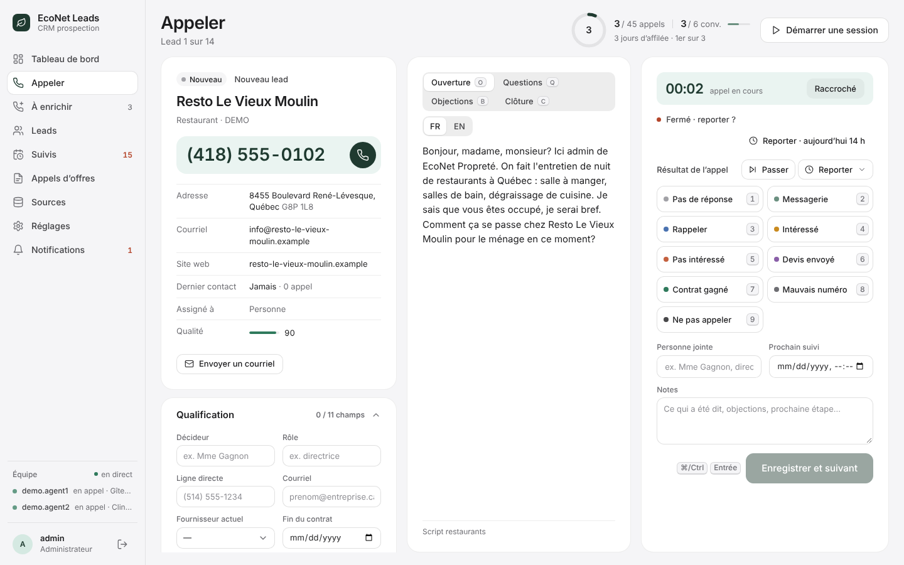 |
| Call screen (phone: tap the number, outcomes under the thumb) | 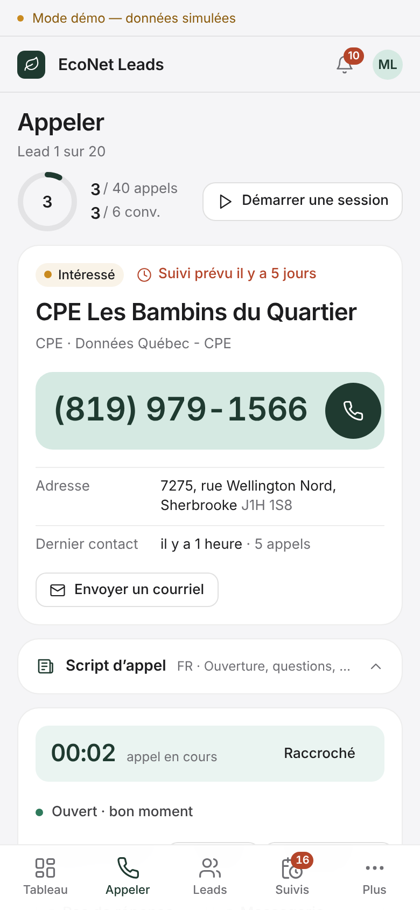 |
| Session mode (running, modal, summary) | 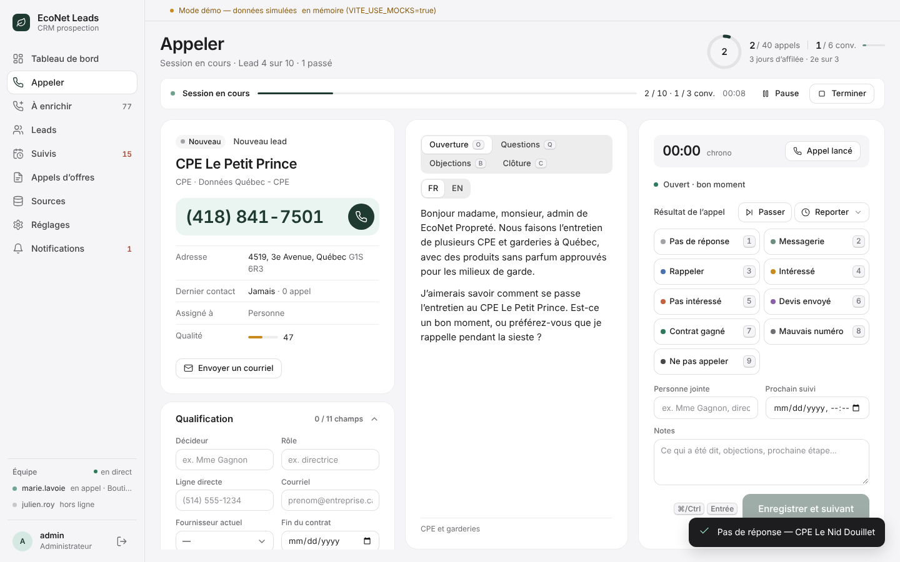 |
| Email composer with estimate | 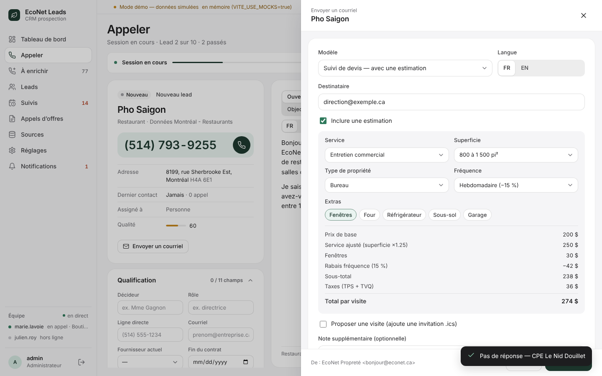 |
| Dashboard | 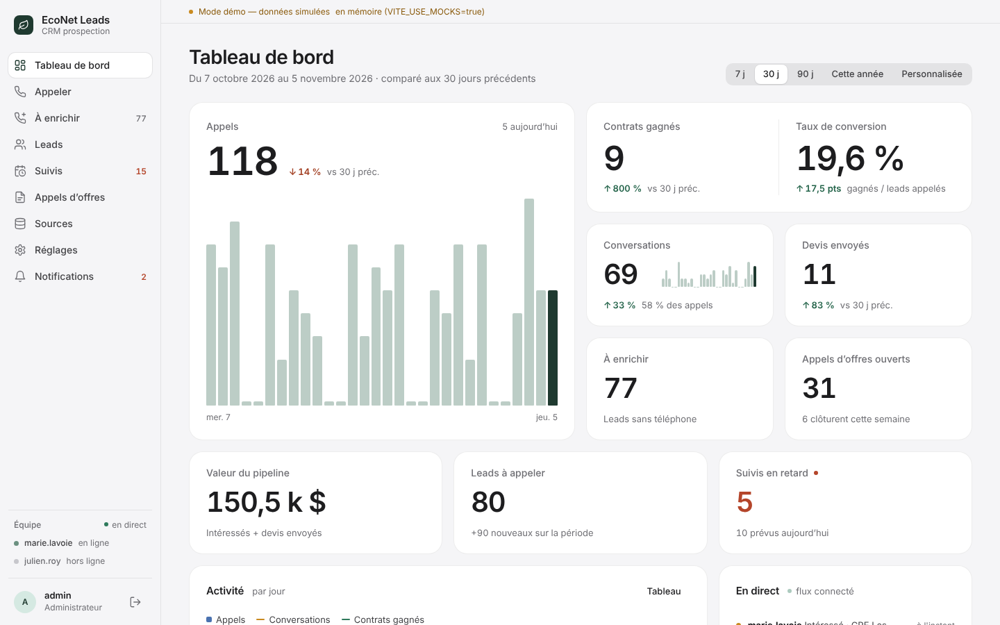 |
| Dashboard insights (funnel, best hours, live feed) | 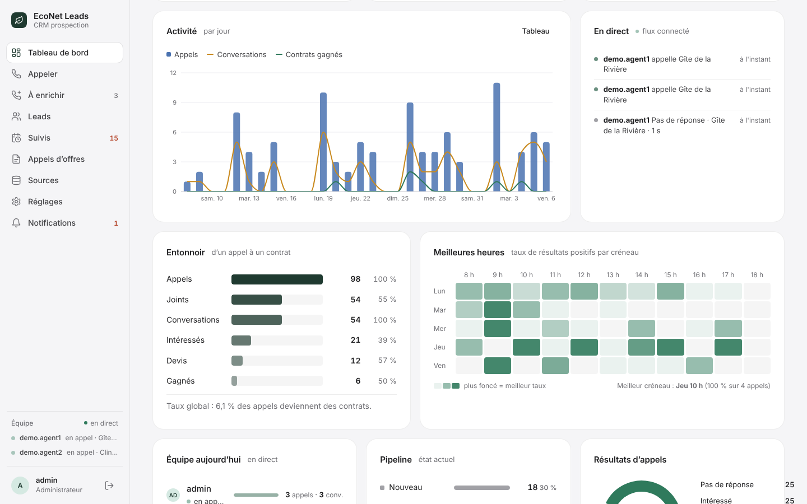 |
| Réglages (scripts) | 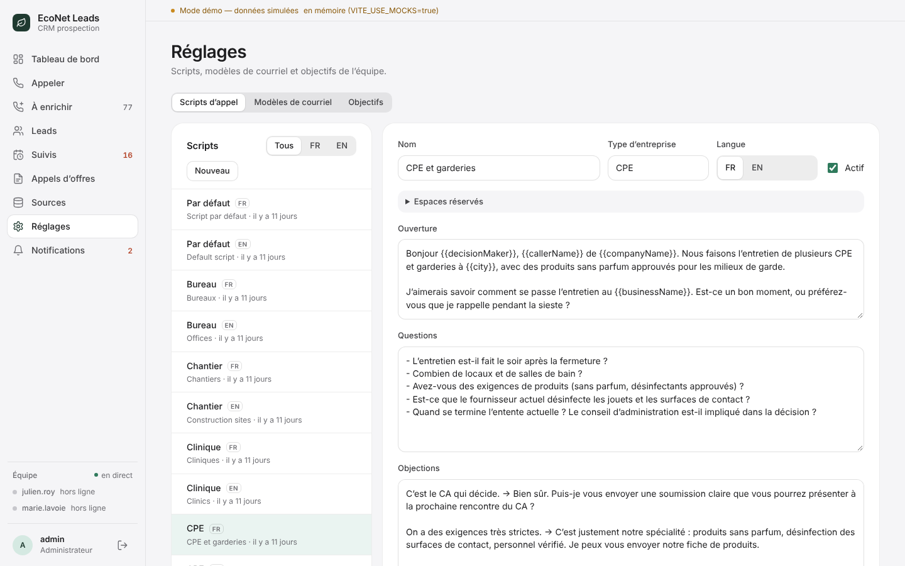 |
| Notifications | 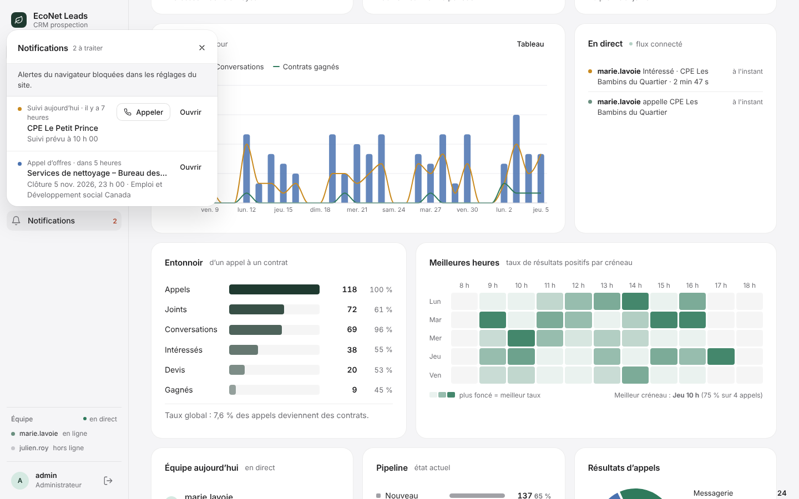 |
| À enrichir | 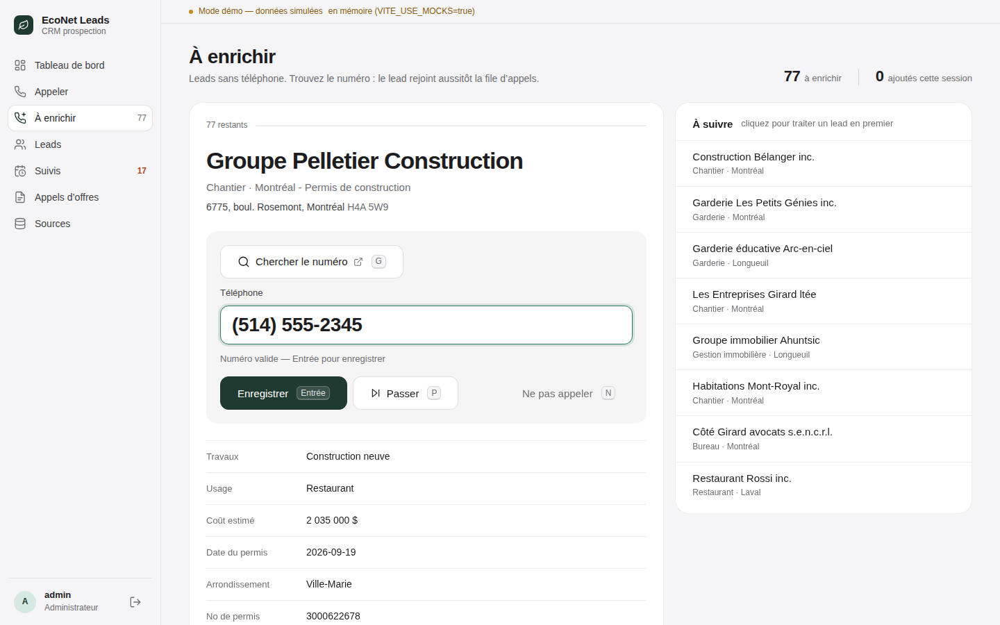 |
| Appels d'offres | 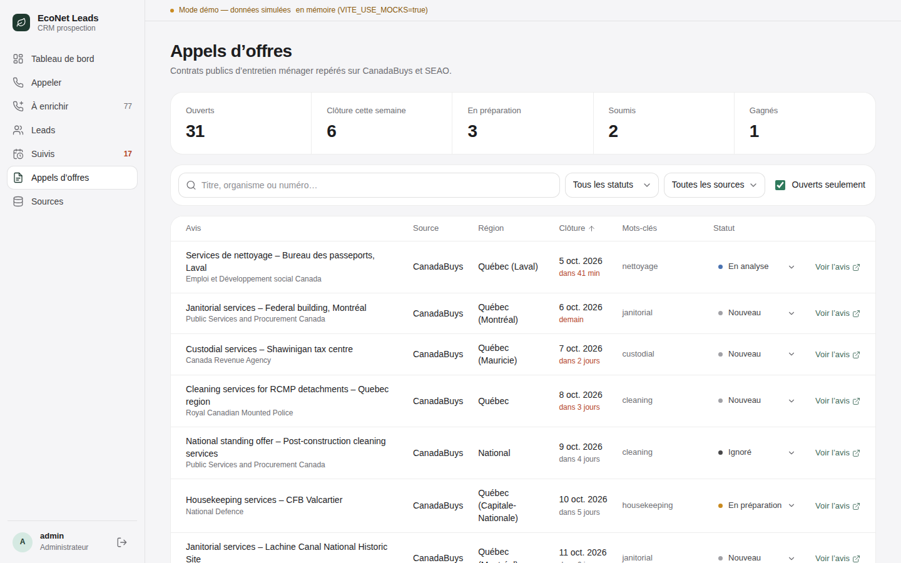 |

More in [`docs/screenshots/`](docs/screenshots/).

## Stack

Vite + React 18 + TypeScript (strict), React Router 6, TanStack Query 5, Recharts,
date-fns (fr). Plain CSS with variables (no UI framework, inline SVG icons).

## Getting started

Requires Node 20+.

```bash
npm install
cp .env.example .env.local   # optional, see below
npm run dev                  # http://localhost:5173 — needs the backend on :8081 (its `local` profile)
npm run dev:mock             # http://localhost:5173 — no backend needed (demo data)
```

The dev server is pinned to port **5173** because the backend's default CORS config
allows `http://localhost:5173`.

### Running against the real backend locally

1. Start PostgreSQL and the backend with the `local` profile (see the backend README):
   `./mvnw spring-boot:run -Dspring-boot.run.profiles=local` → `http://localhost:8081`.
   That profile seeds ~60 demo leads (`dataSource = DEMO`) with 30 days of calls.
2. `npm run dev` (uses `.env.development` → `VITE_API_URL=http://localhost:8081`).
3. Log in as `admin` / `admin123` (local only), or `demo.agent1` / `demo1234` (caller),
   `demo.viewer` / `demo1234` (read-only).

### Environment variables

| Variable | Default | Description |
|---|---|---|
| `VITE_API_URL` | `http://localhost:8080` | Backend base URL, no trailing slash. Baked in at build time. |
| `VITE_USE_MOCKS` | `false` | `true` serves every API call from an in-memory mock. Dev only. |

`.env.development` (committed) keeps mocks **off**. `.env.mock` (committed) turns them
on and is used by `npm run dev:mock` (`vite --mode mock`). Put personal overrides in
`.env.local` / `.env.development.local` (git-ignored).

### Mock mode

`VITE_USE_MOCKS=true` installs a `fetch` interceptor (`src/mocks/`) that implements
every endpoint of the contract with ~150 generated Québec businesses (CPE, cliniques,
restaurants, bureaux… in Montréal, Laval, Longueuil, Québec, Gatineau, Sherbrooke…),
60 days of simulated calls, due/overdue follow-ups, data sources and import jobs, plus
~60 phone-less leads from the business register and Montréal building permits (with
`sourceDetails`) and ~40 CanadaBuys / SEAO tenders. Adding a phone moves the lead into the
call queue; numbers in the fictional 555-01xx range are rejected by the mock server so the
inline server-error state can be seen. ZIP uploads are simulated with progress.
State is kept in memory, so logging a call updates the queue, follow-ups and dashboard;
it resets on page reload. Token expiry (15 min) and refresh are simulated too.
Addendum 3 is mocked as well: claims with TTL, qualification, FR/EN scripts and email
templates, the website's pricing formula, email preview/send (status `configured: true`),
notifications, funnel / best hours / team today / conversion by type, targets. A fake
`EventSource` on `/api/events` sends presence on connect, closes when the token expires
(exercising the refresh-and-reconnect path), and a simulated teammate claims a lead and logs
a call every ~20 s (sometimes a lead from your own queue, which then disappears from it).
Right after a queue fetch, your first claim silently hands the following lead to that
teammate so the 409 "déjà sur ce lead" path shows up (three times at most).

Demo accounts: `admin` / `admin` (ADMIN), `marie.lavoie` / `demo` and `julien.roy` /
`demo` (USER), `lecteur` / `demo` (VIEWER, read-only).

The mock module is loaded with a dynamic `import()` behind
`import.meta.env.VITE_USE_MOCKS === 'true'`, which Vite replaces statically, so it is not
emitted in production builds.

## Adding leads (addendum 4)

Four ways in, all landing in the same leads table:

- **Ajouter un lead** (Leads header, empty call queue, mobile "Plus" menu): live "existe déjà" hints
  while typing, a 409 panel with *Ouvrir* / *Créer quand même*, and on mobile *Ajouter et appeler*
  (opens `/call?leadId=…` with that lead first).
- **Importer** (`/import`): drop a CSV/XLSX or paste cells from a spreadsheet, map the columns
  (prefilled from the header names), check the live preview and the counts of rows without a name or
  phone, then run it and read the added / updated / skipped / invalid summary.
- **Trouver des entreprises** (`/discover`): search a city and categories on OpenStreetMap, tick the
  results (those with a phone in one click), add them as leads. Data © OpenStreetMap contributors.
- **Demandes du site**: a `lead.inbound` event shows a sticky "Nouvelle demande du site … — Appeler"
  toast; the Sources page shows whether the website database is configured
  (`WEBSITE_DB_URL`, `WEBSITE_DB_USERNAME`, `WEBSITE_DB_PASSWORD`).

### Website database (backend environment)

The backend reads the public site's Supabase tables (`booking_requests`, `contact_submissions`)
read-only and never writes to them. Set these on the **backend** (not the CRM):

| Variable | Example |
|---|---|
| `WEBSITE_DB_URL` | `jdbc:postgresql://aws-0-<region>.pooler.supabase.com:5432/postgres?sslmode=require` (Supabase *session pooler*) |
| `WEBSITE_DB_USERNAME` | `postgres.<project-ref>` |
| `WEBSITE_DB_PASSWORD` | the project's database password |
| `app.website.poll-minutes` (`--app.website.poll-minutes=1`, or `APP_WEBSITE_POLL_MINUTES`) | polling interval, default `5` |

Unset, the "Site web – demandes" source stays inactive and the Sources page lists the variable names.
Locally you can point it at any Postgres with the same two tables, e.g.
`WEBSITE_DB_URL=jdbc:postgresql://localhost:5432/econet_website WEBSITE_DB_USERNAME=postgres WEBSITE_DB_PASSWORD=postgres`.
Each new request becomes an INTERESTED lead due now (top of `/call`), announced by the sticky toast
and an `inbound_request` notification within one poll interval.

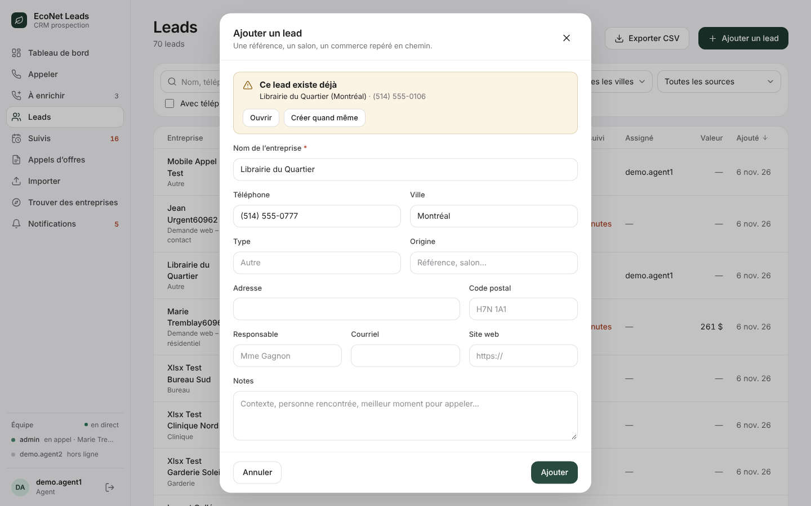
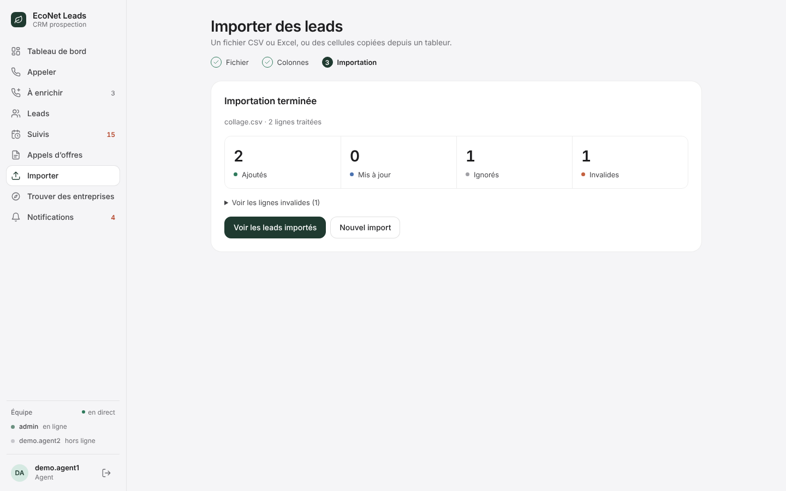
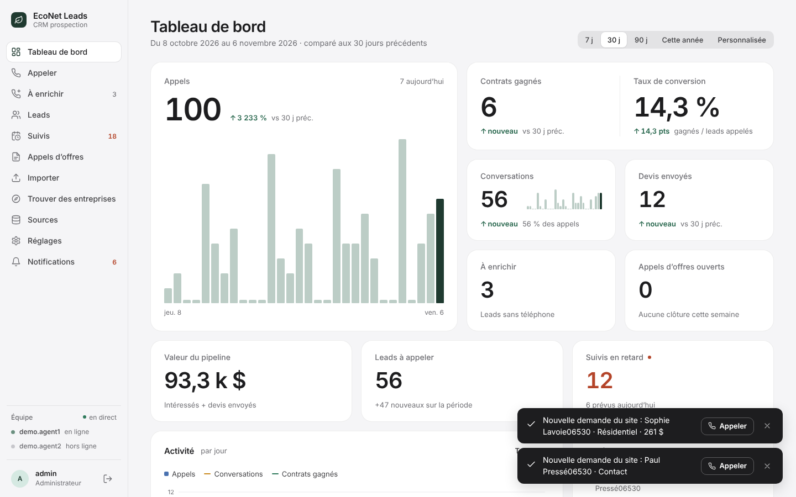
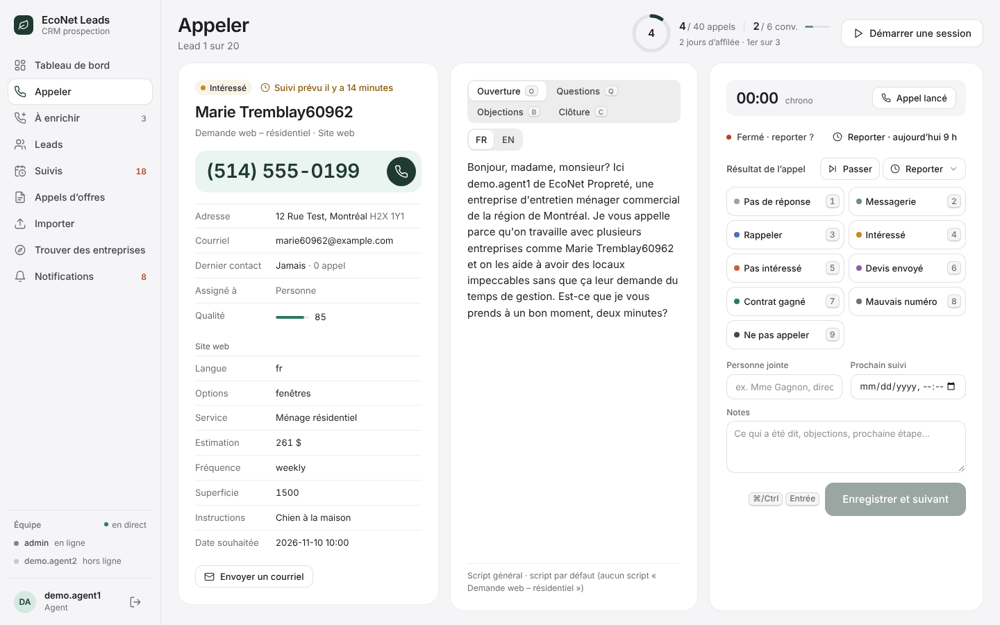

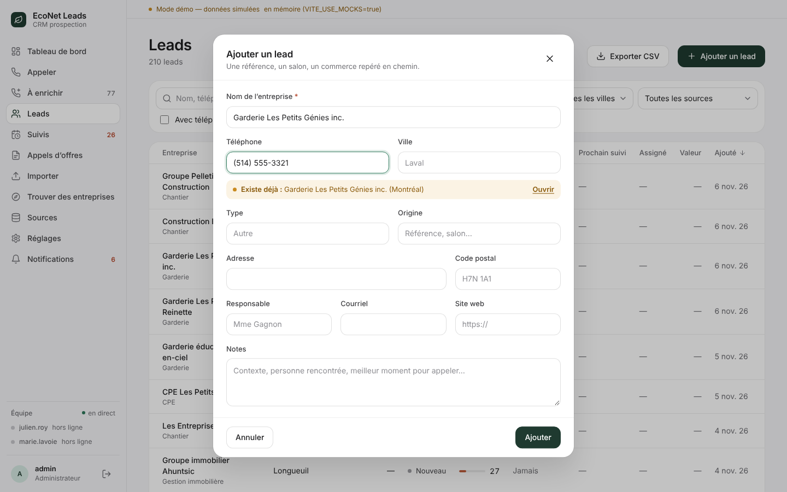
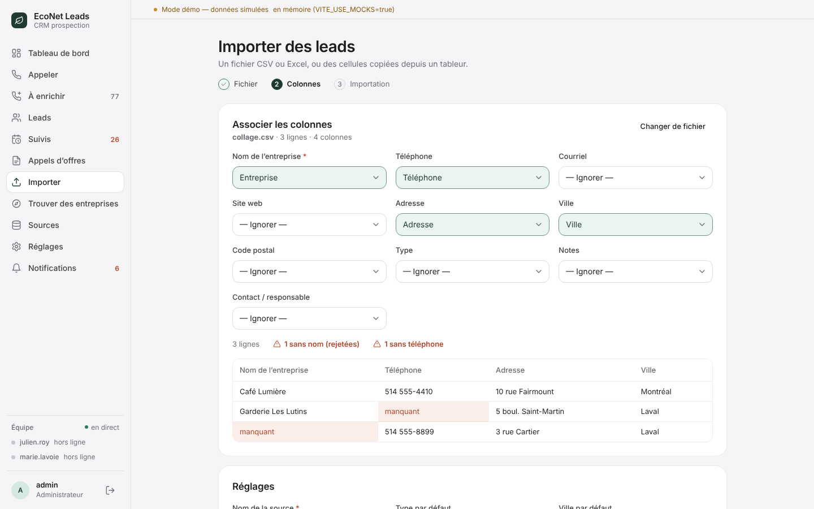
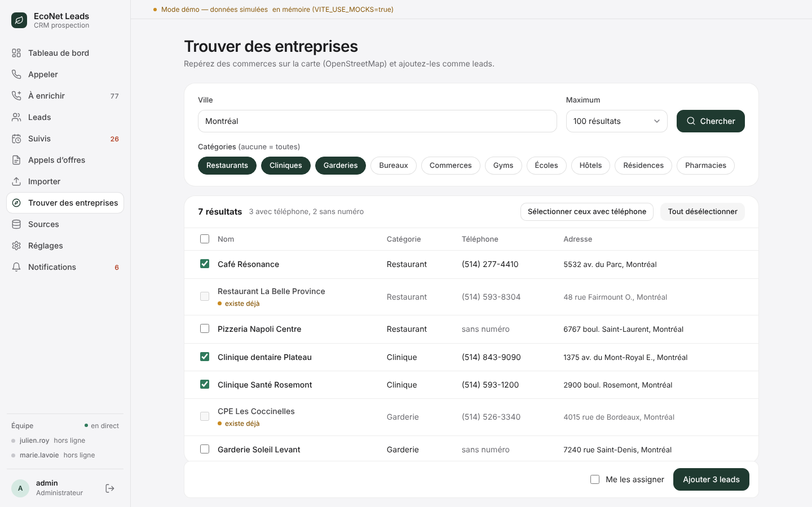
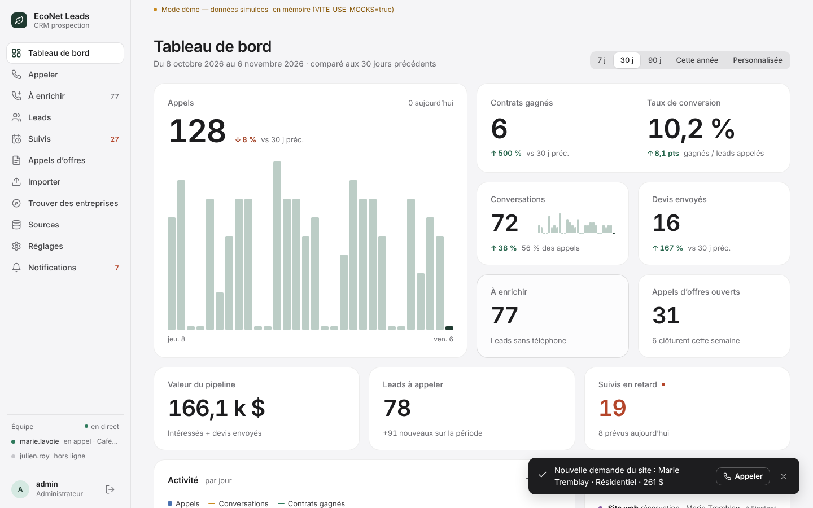

Mock mode simulates all of it: an import pipeline with delimiter sniffing, a fake Overpass answer for
Montréal and Laval (a city called "Panne" returns a 502), and a website request every ~90 s
(`VITE_MOCK_INBOUND_MS` shortens it).

## Scripts

| Script | What it does |
|---|---|
| `npm run dev` | Vite dev server on :5173 against `VITE_API_URL` |
| `npm run dev:mock` | Same, with the in-memory mock API |
| `npm run build` | `tsc -b` (strict type-check) then `vite build` into `dist/` |
| `npm run preview` | Serve `dist/` locally on :5173 |
| `npm run lint` | ESLint (flat config, typescript-eslint, react-hooks) |
| `npm test` | Vitest unit tests (API client refresh flow and uploads, formatting, phone formatter/validator, Google search URL, tender helpers, business-hours heuristic, placeholder substitution and objection parsing, session-mode math, live-store reducer) |

## Project layout

```
src/
  api/          client.ts (fetch wrapper, auth header, {error} parsing, 401 → refresh once → retry),
                session.ts (tokens in localStorage), endpoints.ts (typed calls), types.ts
  auth/         AuthContext (login/logout, role checks)
  live/         useEventSource (SSE + reconnect/refresh), store (reducer: presence, last 50 events),
                LiveProvider (useLive, useLiveEvent, useLiveInvalidate)
  components/   Layout (sidebar / mobile tab bar), OutcomeForm, LeadCard, CallHistory, Widget,
                EmailComposer, NotificationsBell, TeamPresence, call/ (QualificationForm, ScriptPanel,
                TodayRing, OpenNow + SnoozeMenu), session/ (SessionModal, SessionBar, SessionSummary), …
  hooks/        useSavePhone, useUpdateTender, useCallTimer
  lib/          format.ts (CAD, %, phone, French relative dates), dates.ts, status.ts (fixed colours), leadFilters.ts,
                phone.ts (live formatting, validation, search link), tenders.ts (status meta, countdown, URL filters),
                businessHours.ts (America/Montreal heuristic), placeholders.ts ({{…}} + objection pairs),
                callSession.ts (session mode state, summary math, localStorage)
  mocks/        dev-only mock backend (handlers3.ts, live.ts + simulation.ts for SSE, pricing.ts, seedScripts.ts)
  pages/        one file per screen (+ co-located CSS); dashboard/InsightWidgets.tsx, SettingsPage.tsx
```

Auth: tokens are stored in `localStorage`. On a 401 the client calls
`POST /api/auth/refresh` once (shared between concurrent requests) and retries; if that
fails the session is cleared and the route guard sends the user to `/login`.

## Deployment

The build output is a static single-page app (`dist/`). Any static host works; two
things matter:

1. **SPA fallback** — unknown paths must serve `index.html` (client-side routing).
   - Azure Static Web Apps: `public/staticwebapp.config.json` (copied into `dist/`) sets
     `navigationFallback`.
   - Netlify: `public/_redirects` contains `/* /index.html 200`.
2. **Backend URL & CORS** — set `VITE_API_URL` to the public backend URL *at build time*
   (e.g. in the Azure SWA / Netlify build environment), and add the site's origin
   (e.g. `https://leads.econet.ca`) to the backend's `CORS_ALLOWED_ORIGINS`.

Never set `VITE_USE_MOCKS=true` for a deployed build.

Example (Netlify): build command `npm run build`, publish directory `dist`, env
`VITE_API_URL=https://api.example.com`.
Example (Azure Static Web Apps): `app_location: "/"`, `output_location: "dist"`,
`app_build_command: "npm run build"`, with `VITE_API_URL` set in the workflow env.

## Déploiement (Netlify)

Guide pas à pas, sans connaissances techniques. Prérequis : le backend est déjà en ligne sur
Render (voir `DEPLOY.md` dans le dépôt du backend pour sa mise en place, la base de données et
les autres variables) et vous avez son adresse, par exemple `https://econet-leads-api.onrender.com`.

1. Sur [netlify.com](https://app.netlify.com), cliquez **Add new site** > **Import an existing
   project**, choisissez GitHub, puis le dépôt **`Econet-leads-frontend`**.
2. Les réglages de build (commande `npm run build`, dossier `dist`, Node 20, redirection SPA et
   en-têtes de sécurité) sont lus automatiquement depuis `netlify.toml` : ne rien modifier.
3. Avant de déployer, ouvrez **Add environment variables** (ou plus tard **Site configuration >
   Environment variables**) et ajoutez :
   - `VITE_API_URL` = l'adresse du backend Render, **sans « / » à la fin**
     (`https://econet-leads-api.onrender.com`, et non `https://econet-leads-api.onrender.com/`).
4. Cliquez **Deploy**. Si vous ajoutez ou changez la variable après coup, relancez un déploiement
   (**Deploys > Trigger deploy > Clear cache and deploy site**) : elle est lue à la construction.
   Si elle manque, le site affiche « Configuration manquante : VITE_API_URL ».
5. Copiez l'adresse du site obtenue (par exemple `https://econet-leads.netlify.app`) et ajoutez-la
   à la variable **`CORS_ALLOWED_ORIGINS`** du backend sur Render (séparée des autres par une
   virgule, sans « / » final), puis laissez Render redémarrer. Sans cette étape, la connexion
   échouera dans le navigateur.

Ne jamais définir `VITE_USE_MOCKS=true` sur un site déployé.
